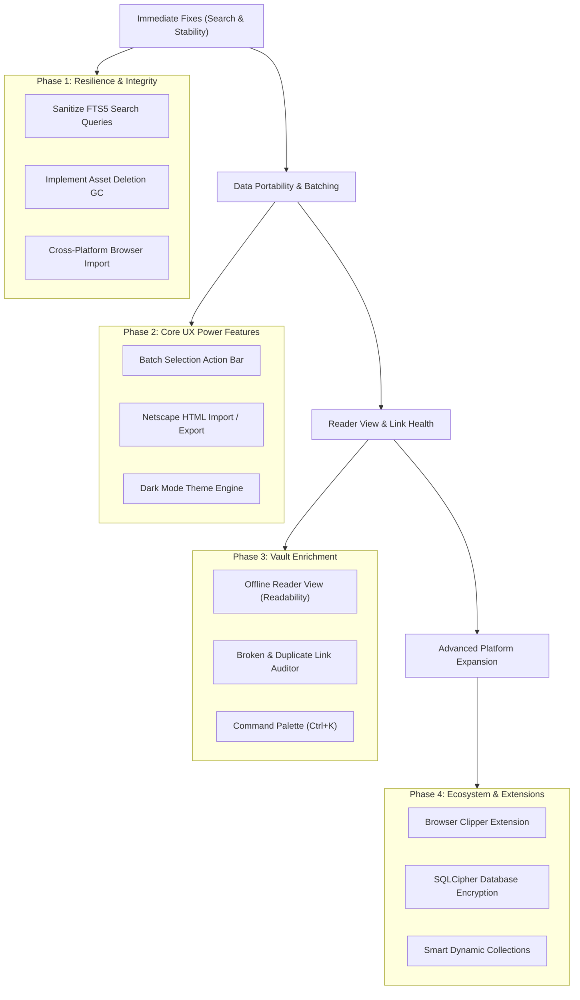

# LinkVault: Comprehensive Project Audit & Feature Roadmap Report

**Document Details:**
- **Product Name:** LinkVault (Bookmark & Media Library Manager)
- **Tech Stack:** Electron 34, React 19, TypeScript, Vite, TailwindCSS, better-sqlite3 (WAL + FTS5), Sharp, Cheerio
- **Audit Date:** October 2026
- **Storage Location:** `reports/project-audit-report.md`

---

## Executive Summary

LinkVault is a high-performance, privacy-conscious desktop bookmark management application built with Electron, React, and SQLite. Its core strengths include local SQLite persistence, full-text search with FTS5, automated metadata and thumbnail extraction via Sharp, a multi-tier privacy system (Method 1 and Method 2 bookmark hiding), custom external browser launching, and multi-browser profile import.

This audit evaluates the codebase across architecture, security, performance, data integrity, user experience, and feature breadth. The findings are divided into two main sections:
1. **Opportunities for Improvement Within Existing Features** (bugs, edge cases, stability, performance, and UX polish).
2. **Recommended Additional Features** (strategic capabilities to elevate LinkVault into a best-in-class desktop bookmark and web research vault).

---

## Part 1: Opportunities for Improvement Within Existing Features

### 1. Search Engine & Query Stability
* **FTS5 Syntax Crash on Special Characters:**
  - *Current State:* In `BookmarkModel.search(query)` (`electron/models/bookmark.model.ts`), the raw input is fed directly into SQLite FTS5: `WHERE bookmarks_fts MATCH ?`.
  - *Vulnerability / Bug:* If a user searches for terms containing FTS5 operators or syntax characters (e.g. `c++`, `user:admin`, `"unclosed quotes`, `*`, `AND`, `OR`, `NOT`, parentheses), SQLite throws an unhandled `fts5: syntax error near ...` query crash.
  - *Recommendation:* Implement a search query tokenizer and sanitizer (e.g., escaping double quotes, transforming multi-term queries into prefix matches `term*`, or stripping reserved FTS5 operators unless formatted intentionally).
* **Unified Global Search:**
  - *Current State:* Search matches against `title`, `url`, `description`, and `notes`. Tags and domain names are stored in relational tables (`bookmark_tags`, `domains`) and are not joined or indexed in `bookmarks_fts`.
  - *Recommendation:* Include tags and domain names in the FTS index or query schema so users can type `#dev` or `github` into the main search box to find bookmarks matching those tags or domains.

---

### 2. Asset Management & Storage Cleanup (Garbage Collection)
* **Orphaned Asset Files on Disk:**
  - *Current State:* Thumbnails and favicons are downloaded as `.bdi` (WebP) files and stored in the user data directory (`userData/assets`). When bookmarks are permanently deleted (`permanentDelete` or `emptyTrash`) or when domains are deleted, their corresponding files on disk are never deleted.
  - *Impact:* Over months of use and large browser imports, gigabytes of abandoned image files accumulate in `userData/assets`.
  - *Recommendation:*
    1. Implement file deletion cleanup hooks on `permanentDelete`, `emptyTrash`, and `deleteDomain`.
    2. Add an **Asset Storage Doctor / Vacuum** tool in Settings to scan `userData/assets`, compare filenames against active database records, and prune unreferenced orphan files.

---

### 3. Database Maintenance, Concurrency & Scalability
* **WAL Checkpointing and Database VACUUM:**
  - *Current State:* `dbManager` sets `journal_mode = WAL`, but no routine `PRAGMA wal_checkpoint(TRUNCATE)` or `VACUUM` is executed during app idle or shutdown.
  - *Impact:* WAL files can grow excessively, especially during bulk browser imports or repeated updates.
  - *Recommendation:* Schedule periodic checkpoints and add an option in Settings (Danger Zone / Database) for "Optimize & Compact Database".
* **Synchronous Main Process I/O:**
  - *Current State:* `better-sqlite3` runs synchronously on Electron's main process thread. While SQLite queries are fast, bulk database operations (e.g., importing 3,000 browser bookmarks) can freeze the main thread and briefly stutter the UI.
  - *Recommendation:* Use chunked transaction batches (e.g., 200 items per transaction) with `setImmediate` yields to prevent UI thread starvation during large imports.

---

### 4. Metadata Extraction & Web Scraping Resilience
* **Single Page Application (SPA) Scraping Limitations:**
  - *Current State:* `MetadataService` uses `net.fetch` and `cheerio` to parse static HTML meta tags (`og:title`, `og:image`, `twitter:image`).
  - *Limitation:* Client-rendered SPAs (e.g. React/Vue sites, Twitter/X, platforms requiring JavaScript execution or cookies) yield generic fallback titles or empty previews.
  - *Recommendation:* Support an optional headless browser fallback (using Electron's hidden `BrowserWindow` or Playwright/Puppeteer) when Cheerio cannot extract metadata or preview images.
* **Scraping Rate-Limiting & Domain Jitter:**
  - *Current State:* The enrichment worker processes pending URLs in rapid succession. If dozens of links belong to the same domain (e.g. during a browser import), the target server may return `429 Too Many Requests` or temporary IP bans.
  - *Recommendation:* Introduce per-domain rate limiting and exponential backoff in `EnrichmentService`.

---

### 5. Cross-Platform Compatibility
* **Hardcoded Windows Paths in Browser Import:**
  - *Current State:* In `BrowserImportService` (`electron/services/browser-import.service.ts`), paths are derived exclusively using `LOCALAPPDATA` and `APPDATA`.
  - *Limitation:* When compiled for macOS or Linux, the browser import feature fails completely.
  - *Recommendation:* Add platform-aware path resolution for macOS (`~/Library/Application Support/Google/Chrome`, etc.) and Linux (`~/.config/google-chrome`, etc.).

---

### 6. Security & Master Password Protection
* **Unencrypted Database at Rest:**
  - *Current State:* The SQLite database and downloaded media are stored unencrypted in plain SQLite files. While the application UI requires a password to unlock, an attacker or other user account on the same PC can inspect `bookmark_manager.sqlite` directly.
  - *Recommendation:* Incorporate database-at-rest encryption (using SQLCipher / `@journeyapps/sqlcipher` or encrypted SQLite extensions).
* **IPC Endpoint Authorization Guarding:**
  - *Current State:* Some controllers check `passwordService.checkAuth()`, while others directly execute queries.
  - *Recommendation:* Implement a unified IPC middleware or decorator that automatically verifies authentication before executing any database mutation when a master password is configured.

---

### 7. User Experience & Interaction Polish
* **Batch Multi-Select Operations:**
  - *Current State:* Bookmarks can only be edited, deleted, hidden, or tagged one by one.
  - *Recommendation:* Introduce multi-selection (checkbox overlay or `Ctrl+Click` / `Shift+Click`), enabling users to bulk-delete, bulk-tag, bulk-move to collection, or bulk-change hide mode.
* **Keyboard Navigation & Accessibility:**
  - *Current State:* Navigation requires mouse clicks.
  - *Recommendation:* Add global keyboard shortcuts (e.g. `Ctrl+K` for global search, `Ctrl+N` for new bookmark, arrow keys for card grid navigation, `Del` key to delete selected card).
* **Dynamic / Responsive Grid Breakpoints:**
  - *Current State:* Grid classes are fixed to `grid-cols-1 md:grid-cols-2 lg:grid-cols-3 xl:grid-cols-4`.
  - *Recommendation:* Allow users to toggle between **Comfortable Grid**, **Compact Grid**, and **Detailed List View**.

---

## Part 2: Recommended Additional Features

The following features are prioritized by user value, implementation feasibility, and synergy with LinkVault's core philosophy.

### Tier 1: High Priority (Core Value Multipliers)

```
+-----------------------------------------------------------------------------------+
|                            TIER 1 HIGH PRIORITY ROADMAP                           |
+------------------------------------+----------------------------------------------+
| 1. Netscape HTML Import / Export   | Full bookmark interoperability across all    |
|                                    | browsers (Chrome, Edge, Safari, Firefox)     |
+------------------------------------+----------------------------------------------+
| 2. Batch / Multi-Select Management | Select multiple bookmarks to bulk delete,    |
|                                    | tag, assign collection, or toggle privacy    |
+------------------------------------+----------------------------------------------+
| 3. Reader View & Offline Archive   | Distraction-free article reader mode with    |
|                                    | saved offline snapshot (no link rot)         |
+------------------------------------+----------------------------------------------+
| 4. Command Palette (Ctrl+K)        | Instant modal to search, run commands,       |
|                                    | jump to tags, or paste links from anywhere   |
+------------------------------------+----------------------------------------------+
| 5. Dark Mode & UI Theming          | Native dark theme support with system        |
|                                    | appearance synchronization                   |
+------------------------------------+----------------------------------------------+
```

#### 1. Standard Netscape HTML Import and Export
- **Why:** Every mainstream browser (Chrome, Firefox, Safari, Edge, Brave) and bookmark manager supports the Netscape Bookmark HTML format (`<!DOCTYPE NETSCAPE-Bookmark-file-1>`).
- **Feature Capabilities:**
  - Export all bookmarks (or specific collections/tags) to an HTML file to import into any browser.
  - Import external HTML files while preserving folder structure as LinkVault Collections and tags.
  - Include JSON and CSV export formats for data portability and spreadsheet analysis.

#### 2. Multi-Select & Batch Action Bar
- **Why:** Managing a large library of bookmarks link-by-link is tedious.
- **Feature Capabilities:**
  - Selection mode triggered by a multi-select toggle or holding `Shift`/`Ctrl`.
  - Floating bottom action bar offering:
    - *Add to Collection*
    - *Add / Remove Tags*
    - *Change Hide Mode (Method 1 / Method 2 / Visible)*
    - *Mark as Favorite / Important*
    - *Move to Recycle Bin*

#### 3. Distraction-Free Reader Mode & Offline Archiving (Combating Link Rot)
- **Why:** Web pages frequently change, move behind paywalls, or shut down ("link rot").
- **Feature Capabilities:**
  - **Reader View:** Integrated Mozilla Readability engine that parses the main article text, removes ads, trackers, and clutter, and presents clean typography.
  - **Offline Web Archive:** Automatically caches the parsed article text or single-file MHTML snapshot so users can read the content even if the original website goes offline or when working without an internet connection.

#### 4. Global Command Palette (`Ctrl+K` / `Cmd+K`)
- **Why:** Power users want instantaneous keyboard-driven navigation without reaching for the mouse.
- **Feature Capabilities:**
  - Accessible from any view via `Ctrl+K`.
  - Fuzzy searches across bookmarks, tags, collections, and settings.
  - Allows quick actions: "Add Bookmark", "Go to Settings", "Empty Recycle Bin", "Toggle Show Hidden Bookmarks".

#### 5. Dark Mode & Custom Accent Colors
- **Why:** LinkVault currently defaults to bright white backgrounds, which causes eye strain in low-light environments.
- **Feature Capabilities:**
  - Light, Dark, and System Auto mode.
  - Semantic CSS theme tokens using Tailwind's `dark:` variant.

---

### Tier 2: Medium Priority (Workflow & Organization Enhancements)

#### 6. Broken Link & Duplicate Link Auditor
- **Features:**
  - Background health checker that pings saved URLs periodically.
  - Flags dead links (`404 Not Found`, `500 Server Error`, DNS failures).
  - Duplicate detection that identifies exact URLs as well as normalized URLs (differing only by trailing slashes, UTM tracking parameters, or `http` vs `https`).

#### 7. Smart Dynamic Collections (Saved Filters)
- **Features:**
  - Rule-based dynamic collections that automatically populate bookmarks based on conditions:
    - E.g.: "Added in the last 7 days"
    - E.g.: "Has no tags"
    - E.g.: "Domain is youtube.com or vimeo.com"
    - E.g.: "Contains notes"

#### 8. Hierarchical / Nested Collections & Sub-Tags
- **Features:**
  - Folder-tree hierarchy for collections (e.g. `Development > Frontend > React`).
  - Drag-and-drop tree structure in the sidebar.

#### 9. Browser Companion Extension / Quick Clipper
- **Features:**
  - A lightweight WebExtension (Chrome/Firefox/Edge) connecting to a local lightweight HTTP/WebSocket daemon in LinkVault.
  - Allows one-click saving from the browser directly into LinkVault without switching windows or copying/pasting URLs manually.

#### 10. System Tray Companion & Global Hotkey
- **Features:**
  - Minimize to system tray on close (Windows/Linux) or menu bar (macOS).
  - Global hotkey (e.g. `Ctrl+Alt+B` or `Cmd+Shift+B`) that opens a quick popup anywhere in the OS to paste or capture the current clipboard link.

---

### Tier 3: Advanced & Long-Term Innovations

#### 11. AI-Assisted Auto-Tagging & Smart Summaries
- **Features:**
  - Local AI integration (e.g. Ollama or ONNX runtime) or optional API key (OpenAI/Gemini/Claude).
  - Automatically suggests 3–5 relevant tags based on article content.
  - Generates a concise 2-sentence summary saved into the bookmark's description or notes.

#### 12. Full-Text Search Within Page Content
- **Features:**
  - Indexes not only the metadata (title and description) but also the full scraped article text in `bookmarks_fts`.
  - Enables finding bookmarks based on a specific paragraph or sentence remembered from an article read months ago.

#### 13. End-to-End Encrypted Cloud Sync (Optional Multi-Device)
- **Features:**
  - Self-hostable sync server (or WebDAV / Nextcloud / S3-compatible backend).
  - End-to-end client-side encryption (E2EE) using user passphrase before payloads leave the device.

---

## Action Plan & Recommended Next Steps



### Suggested Implementation Order:
1. **Week 1 (Stability & Data Integrity):**
   - Sanitize FTS5 search queries to eliminate syntax crashes.
   - Implement asset garbage collection upon permanent bookmark/domain deletion.
   - Refactor browser import paths for macOS/Linux compatibility.
2. **Week 2 (Core Usability):**
   - Netscape HTML Import & Export.
   - Multi-Select action bar for batch tagging and deleting.
   - Native Dark Mode toggle.
3. **Week 3 (Power User Tools):**
   - Command Palette (`Ctrl+K`).
   - Broken link and duplicate URL auditor.
   - Distraction-free offline Reader Mode.

---
*Report prepared and validated for LinkVault. Saved to [reports/project-audit-report.md](file:///i:/Project/Hobby/media-gallery/reports/project-audit-report.md).*
